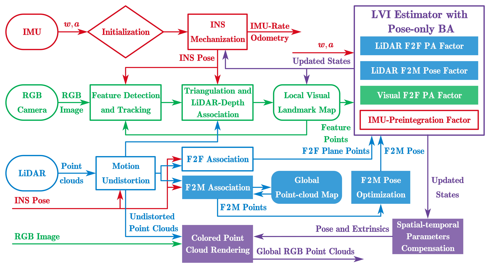

# PA-LVIO: Real-Time LiDAR-Visual-Inertial Odometry and Mapping with Pose-Only Bundle Adjustment

We propose a novel LiDAR-Visual-Inertial Odometry (LVIO) for real-time navigation and mapping. PA-LVIO employs a pose-only bundle adjustment (PA) framework, which is highly accurate and efficient, for both frame-to-frame (F2F) LiDAR and visual measurements. Meanwhile, a marginalization-free and frame-to-map (F2M) LiDAR measurement model is integrated into PA-LVIO to eliminate odometry drifts. Besides, an IMU-centric online spatial-temporal calibration is employed to obtain a pixel-wise LiDAR-camera alignment for high-quality and RGB-rendered mapping.



**Author:** Hailiang Tang from the [Integrated and Intelligent Navigation (i2Nav) Group](http://www.i2nav.com/), GNSS Research Center, Wuhan University.

**Related Paper:**

- H. Tang, T. Zhang, L. Wang, M. Yuan, and X. Niu, “BA-LINS: A Frame-to-Frame Bundle Adjustment for LiDAR-Inertial Navigation,” *IEEE Transactions on Intelligent Transportation Systems*, vol. 26, no. 5, pp. 6621–6634, May 2025, doi: [10.1109/TITS.2024.3524569](https://doi.org/10.1109/TITS.2024.3524569). (***Recommended for citation***)
- H. Tang, T. Zhang, L. Wang, G. Wang, and X. Niu, “PO-VINS: An Efficient and Robust Pose-Only Visual–Inertial State Estimator With LiDAR Enhancement,” *IEEE Transactions on Instrumentation and Measurement*, vol. 74, pp. 1–17, 2025, doi: [10.1109/TIM.2025.3632451](https://doi.org/10.1109/TIM.2025.3632451).(***Recommended for citation***)
- H. Tang, T. Zhang, L. Wang, X. Ding, M. Yuan, and X. Niu, “PA-LVIO: Real-Time LiDAR-Visual-Inertial Odometry and Mapping with Pose-Only Bundle Adjustment,” Mar. 17, 2026, *arXiv*: arXiv:2603.16228. doi: [10.48550/arXiv.2603.16228](https://doi.org/10.48550/arXiv.2603.16228). (***This paper will never be officially published***)

## News

- [2026-03-19] Add the preprint paper.
- [2026-11-06] Release the source codes.

## 1 Prerequisites

PA-LVIO is developed and tested on **Ubuntu 20.04** with **ROS Noetic**, and the following dependencies are required to compile it (all of them are already installed in the docker image):

- [ROS Noetic](http://wiki.ros.org/noetic/Installation/Ubuntu) (ros-noetic-ros-base, ros-noetic-perception for PCL)
- gcc (>= 8.0) and cmake
- [Livox-SDK](https://github.com/Livox-SDK/Livox-SDK) (2.3.0) and [livox_ros_driver](https://github.com/Livox-SDK/livox_ros_driver)
- [abseil-cpp](https://github.com/abseil/abseil-cpp)
- [oneTBB](https://github.com/oneapi-src/oneTBB)
- [Ceres Solver](https://github.com/ceres-solver/ceres-solver) (>= 2.2.0)
- [OpenCV](https://github.com/opencv/opencv) (>= 3.4)
- [yaml-cpp](https://github.com/jbeder/yaml-cpp), Eigen3, glog

The versions used in our environment are given in [docker/Dockerfile](docker/Dockerfile).

## 2 Docker

### 2.1 Build the docker image

```bash
cd docker
docker build -t pa-lvio:latest .
```

The image is built on `nvidia/cudagl:11.4.2-devel-ubuntu20.04`, and an NVIDIA GPU is required. It contains ROS Noetic, Livox-SDK, abseil-cpp, oneTBB, Ceres Solver 2.2.0, OpenCV 4.12.0 (CUDA and TBB enabled), and `livox_ros_driver` (in `~/catkin_ws`). The APT and pip sources are replaced with mirrors for mainland China users.

⚠️RVIz are not installed in the docker.

### 2.2 Run the docker container

To run the container with GPU support:

```shell
docker run -it --gpus all --net=host -v /media:/media:rw pa-lvio:latest
```

Then compile PA-LVIO in the container:

```shell
mkdir -p ~/workspace/src
cd ~/workspace/src
git clone https://github.com/i2Nav-WHU/PA-LVIO.git
cd ~/workspace
catkin_make -DCMAKE_BUILD_TYPE=Release
source ~/workspace/devel/setup.zsh
```

## 3 Open the container in VSCode

PA-LVIO can be developed and compiled in the docker container via the [Dev Containers](https://marketplace.visualstudio.com/items?itemName=ms-vscode-remote.remote-containers) extension of VSCode.

1. Install [Docker](https://docs.docker.com/engine/install/) and [VSCode](https://code.visualstudio.com/), and build the docker image first (see [Section 2.1](#21-build-the-docker-image));
2. Install the **Dev Containers** extension in VSCode;
3. Open the local repository in VSCode:

   ```shell
   cd PA-LVIO
   code .
   ```
4. Press `Ctrl+Shift+P` and run **Dev Containers: Reopen in Container**. The container is created from the `pa-lvio:latest` image according to [.devcontainer/devcontainer.json](.devcontainer/devcontainer.json), with GPU (`--gpus all`) and host network (`--net host`) enabled. The repository is mounted at `/home/lvio/workspace/src/PA-LVIO`, and the host `/media` directory is also mounted for datasets;
5. Wait for the container to start. The default terminal is zsh, and the ROS environment (`/opt/ros/noetic`, `~/catkin_ws` for `livox_ros_driver`, and `~/workspace/devel`) is sourced automatically.

### 3.1 Compile in VSCode

The build directory and devel space of the catkin workspace have been configured in [.vscode/settings.json](.vscode/settings.json):

- **Terminal**: open a terminal in VSCode, then

  ```shell
  cd ~/workspace
  catkin_make -DCMAKE_BUILD_TYPE=Release
  ```
- **CMake Tools**: the CMake Tools extension is installed automatically in the container. Configure the project with `CMake: Configure` (`Ctrl+Shift+P`), then build it with `CMake: Build` (`F7`). The build files are written to `/root/workspace/build`.

After the compilation, run PA-LVIO with:

```shell
source ~/workspace/devel/setup.zsh
roslaunch pa_lvio lvio_read.launch configfile:=~/workspace/src/PA-LVIO/config/lvio_i2nav.yaml bagfile:=/media/path/to/your.bag
```

## 4 Run PA-LVIO

PA-LVIO provides three launch files, and the configuration file must be given by the `configfile` argument:

```shell
# Offline, read the bag file directly, with rviz visualization
roslaunch pa_lvio lvio_read.launch configfile:=.../lvio.yaml bagfile:=.../dataset.bag

# Offline, read the bag file directly, without visualization (faster)
roslaunch pa_lvio lvio_play.launch configfile:=.../lvio.yaml bagfile:=.../dataset.bag

# Online mode, subscribing live topics
roslaunch pa_lvio lvio.launch configfile:=.../lvio.yaml
```

You are recommended to use tools like [Foxglove](https://app.foxglove.dev/) for visualization with the layout file `config/lvio-foxglove.json`. You can also use your local RVIz with the configuration file `config/lvio-rviz.rviz`.

## 5 Datasets

### 5.1 Format

PA-LVIO supports exactly the same data formats as [LE-VINS](https://github.com/i2Nav-WHU/LE-VINS) and [FF-LINS](https://github.com/i2Nav-WHU/FF-LINS):

- The IMU frame should be **front-right-down**. The initial alignment of attitude is required to output the navigation result in the NED frame;
- The image can be either `sensor_msgs::Image` or `sensor_msgs::CompressedImage`;
- The point cloud can be either `sensor_msgs::PointCloud2` or the customized message defined by `livox_ros_driver`.

In addition to the LiDARs supported by LE-VINS (**Livox, Velodyne, Ouster**), PA-LVIO additionally supports **Hesai** LiDARs, which is specified by the `lidar_type` item (Livox: 1; Velodyne: 2; Ouster: 3; Hesai: 4) in the `lidar` section of the configuration file.

### 5.2 Supported datasets

The configuration files for different datasets are stored in the [config](config) folder:

| Configuration file                          | Dataset                                                 | Platform      | LiDAR       | IMU       |
| :------------------------------------------ | :------------------------------------------------------ | ------------- | :---------- | :-------- |
| [lvio_i2nav.yaml](config/lvio_i2nav.yaml)   | [i2Nav-Robot](https://github.com/i2Nav-WHU/i2Nav-Robot) | Wheeled robot | Hesai AT128 | ADIS16465 |
| [lvio_mars.yaml](config/lvio_mars.yaml)     | [MARS-LVIG](https://mars.hku.hk/dataset.html)           | UAV           | Livox Avia  | built-in  |
| [lvio_r3live.yaml](config/lvio_r3live.yaml) | [R3LIVE](https://github.com/ziv-lin/r3live_dataset)     | Handheld      | Livox Avia  | built-in  |

#### 5.2.1 i2Nav-Robot dataset

The [i2Nav-Robot](https://github.com/i2Nav-WHU/i2Nav-Robot) dataset was collected by our group with the Hesai AT128 LiDAR, the ADIS16465 IMU, and an AVT camera. The topics are `/hesai/at128/points`, `/adi/adis16465/imu`, and `/avt_camera/left/image/compressed`. The images are compressed, and the point cloud is `sensor_msgs::PointCloud2`.

#### 5.2.2 MARS-LVIG dataset

The [MARS-LVIG](https://mars.hku.hk/dataset.html) dataset provides aerial (UAV) sequences collected by Livox Avia with a built-in IMU and a hardware-synchronized global-shutter camera. The image topic is `/cam0`, and the images are recorded in the **CompressedImage** format. Please be careful about the following issues:

- You should change the IMU data into the **front-right-down** format.
- The camera and IMU are not well synchronized.

#### 5.2.3 R3LIVE dataset

The [R3LIVE](https://github.com/ziv-lin/r3live_dataset) dataset provides indoor and outdoor handheld sequences collected by Livox Avia with a built-in IMU and a global-shutter camera. The image topic is `/cam0`, and the images are recorded in the **CompressedImage** format. Please be careful about the following issues:

- You should change the IMU data into the **front-right-down** format;
- The camera and IMU are not well synchronized.

### 5.3 Your own dataset

To run PA-LVIO on your own dataset:

1. Record the IMU, image, and LiDAR data into a ROS bag file. The IMU frame should be front-right-down (see [Section 5.1](#51-format));
2. Copy the [lvio.yaml](config/lvio.yaml) file and modify the topics in the `ros` section, the IMU parameters in the `imu` section, the camera intrinsics and extrinsics in the `visual` section, and the LiDAR parameters and extrinsics in the `lidar` section;
3. Run PA-LVIO with the new configuration file (see [Section 4](#4-run-pa-lvio)).

### 5.4 Evaluation

The output navigation results can be evaluated with the ground truth using [evo](https://github.com/MichaelGrupp/evo).

## 6 License

PA-LVIO is released under GPLv3 license, and it can only be used for academic purposes.

## 7 Contact

Please contact **Dr. Hailiang Tang** ([thl@whu.edu.cn](mailto:thl@whu.edu.cn)) or open an issue at this repository for any technical issues.
